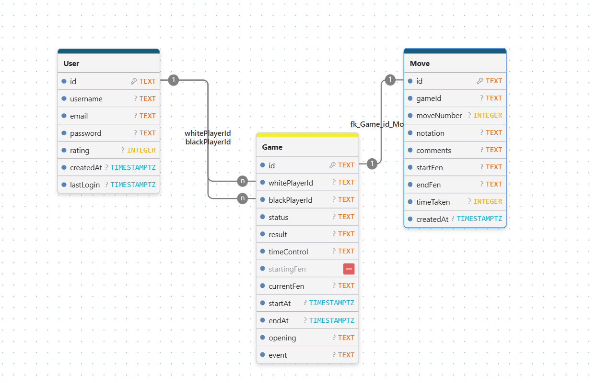
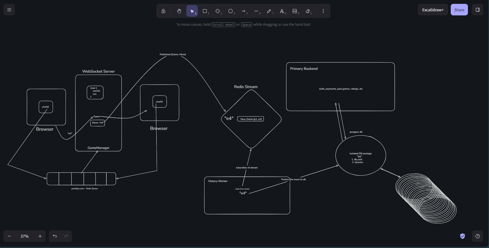
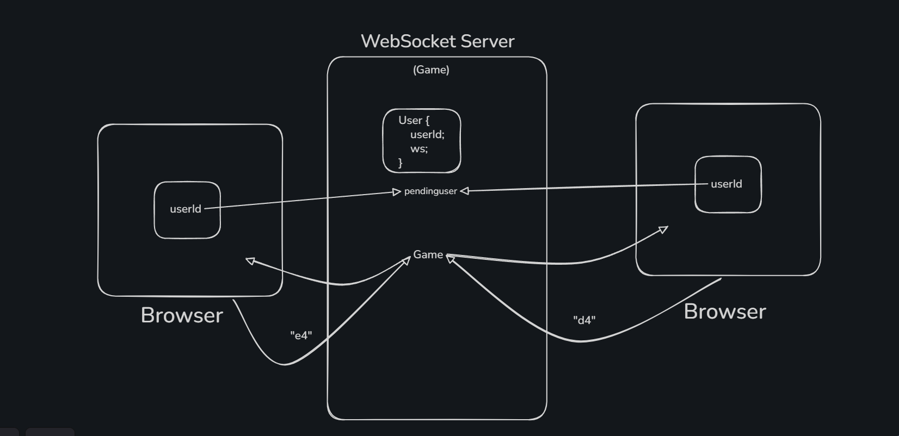

# ♜ Chess

A simple real-time chess app.

## Project flow

1. Open the app in the browser.
2. Start a new game.
3. The server pairs two players.
4. One player becomes White and the other becomes Black.
5. Players make moves on the board.
6. The server checks if each move is valid.
7. The other player sees the move right away.
8. The move history can be saved later by the worker.

## Diagrams

### ER Diagram

### High Level Design

### WebSocket Flow

## Main parts

- apps/web - the chess website
- apps/mobile - the Expo React Native mobile app
- apps/native - the WebSocket game server
- apps/history-worker - background worker for move history
- packages/db - database schema and queries
- packages/types - shared TypeScript types
- packages/ui - shared UI components
